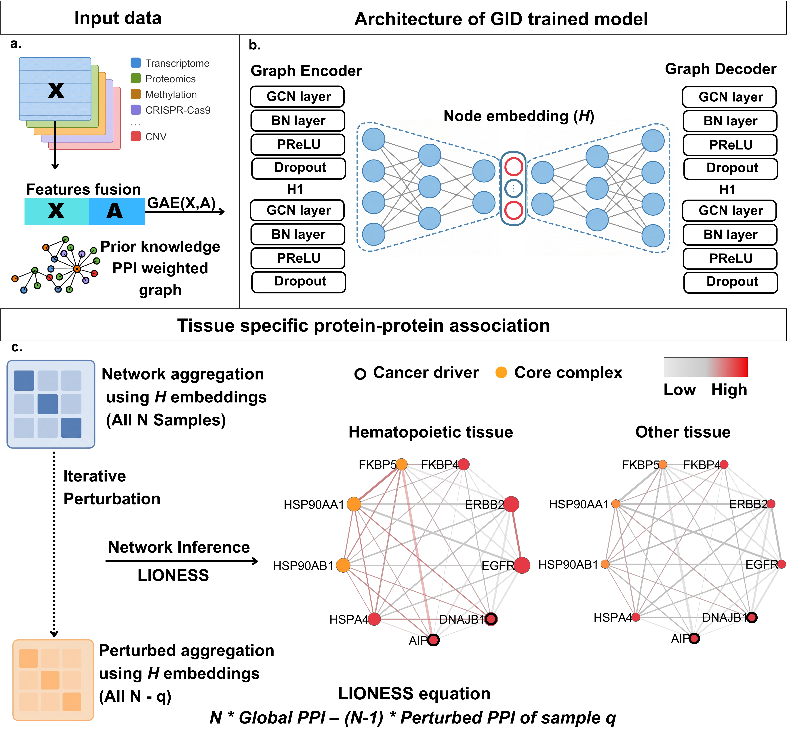

# GID: Graph Inferred Deconvolution



GID infers a protein–protein association network for every sample of a multi-omics cohort. A graph convolutional
autoencoder is trained on the omic profiles of the genes, with STRING as the prior network. The cosine similarity of the
learned gene embeddings gives a population level network, and a leave-one-out step in the style of LIONESS turns it into
one network per sample. The average of the sample networks within a tissue is the tissue level network.

This repository holds the code of the manuscript *Graph inferred deconvolution of sample-specific protein–protein
association networks* (Emam, Monteiro, Gonçalves and Antunes): the model, the analysis of 1,007 cancer cell lines of the
Cancer Dependency Map (five omic layers, 28 tissue types), the comparison with LIONESS, SSN and BONOBO, the mutation
analysis, the TCGA-BRCA validation and the code of the figures.

## Installation

```
git clone https://github.com/Mohamedema/GID.git
cd GID
conda env create -f environment.yml
conda activate gid
```

The environment file installs the package in editable mode. Without conda, `pip install -r requirements.txt` followed by
`pip install -e .` does the same. On a GPU machine install the CUDA build of PyTorch first (pytorch.org) and use
`--device cuda` when training.

The figures are drawn with R 4.3 or newer and the packages ggplot2, dplyr, tidyr, readr, stringr, ggrepel, cowplot,
scales, circlize, ComplexHeatmap, ape and ggsci (ragg and ggrastr are used when they are installed). Cytoscape with the
py4cytoscape package is needed only for the network figures.

The code is tested with Python 3.13, PyTorch 2.15, PyTorch Geometric 2.8, pandas 3.1, NumPy 2.5 and scikit-learn 1.9. The
tests also pass with pandas 2.2, NumPy 2.1 and scikit-learn 1.5.

## Data

The raw files come from Cell Model Passports, Project Score, STRING and the resources listed in
[`data/README.md`](data/README.md), which also gives the file names that the scripts expect and the table that each step
writes. Put the downloads in `data/raw/`.

## Running the analysis

Every step is a module with its own command line (`python -m gid.<module> --help`). The scripts in `scripts/` run the
steps in order. `RAW` is the folder with the downloads (`data/raw` by default) and `DEVICE` is `cpu` or `cuda`.

```
DEVICE=cuda bash scripts/run_depmap.sh      # cell lines, STRING as prior network
DEVICE=cuda bash scripts/run_tcga.sh        # TCGA-BRCA tumours
DEVICE=cuda bash scripts/run_hippie.sh      # cell lines, HIPPIE as prior network
bash scripts/make_figures.sh
```

The steps of `run_depmap.sh` one at a time:

**1. Input.** Missing values are replaced by the feature mean and recorded in a mask, the 20% of features with the lowest
variance are dropped in each layer, and the genes found in all five layers and in STRING (1,998) are kept. The STRING
scores are rescaled to [0, 1] among these genes.

```
python -m gid.preprocess --raw data/raw --out data/depmap
```

**2. Training.** The hyperparameters are in `configs/depmap_gid.json` (Table 1 of the manuscript); the seed is 42. With
`--layers` the model is trained on one layer only, which gives the single omic models of Figure 2.

```
python -m gid.train --data data/depmap --out runs/depmap/all_omics --config configs/depmap_gid.json --device cuda
python -m gid.train --data data/depmap --out runs/depmap/protein --layers protein --config configs/depmap_gid.json
```

**3. Networks.** The population network, the network of every sample (LIONESS in the embedding space) and the tissue
networks. The sample networks are written as the upper triangle of each matrix, about 8 GB for the cell lines.

```
python -m gid.infer --data data/depmap --model runs/depmap/all_omics/model.pt --out runs/depmap/all_omics --device cuda
```

**4. Evaluation.** Recovery of CORUM and STRING pairs by the population network (ROC), resolution of the tissue of origin
by the sample networks (Calinski–Harabasz and Davies–Bouldin indices, tissue and organ system similarity), and the
benchmark against LIONESS, SSN and BONOBO. `--name` labels the output files; the single omic models are evaluated in the
same way with their own name.

```
python -m gid.evaluate --data data/depmap --population runs/depmap/all_omics/population_network.npy \
    --corum data/raw/corum_humanComplexes.txt --name all_omics --out results
python -m gid.resolution --data data/depmap --networks runs/depmap/all_omics/sample_networks.npy \
    --name all_omics --anatomy data/tissue_anatomy.csv --similarity --out results
python -m gid.benchmark --data data/depmap --networks runs/depmap/all_omics/sample_networks.npy --out results/benchmark
```

**5. Tissue level analyses.** The probability that a pair is associated in each tissue, the CORUM complexes specific to a
tissue (95th percentile of each tissue network, density of the complex, 90th percentile rule) and the overlap between
tissues (Jaccard index of the top 60% of the pairs, overall and within each reference resource).

```
python -m gid.association --data data/depmap --networks runs/depmap/all_omics/sample_networks.npy --out results
python -m gid.complexes --networks runs/depmap/all_omics/tissue_networks.npy --names runs/depmap/all_omics/tissue_names.txt \
    --genes data/depmap/genes.txt --corum data/raw/corum_humanComplexes.txt --out results
python -m gid.conservation --data data/depmap --networks runs/depmap/all_omics/tissue_networks.npy \
    --names runs/depmap/all_omics/tissue_names.txt --references data/raw --out results
```

CORUM lists a subunit twice in a few complexes. `gid.complexes --unique-genes` counts such a subunit once; without it the
complex is counted as listed.

**6. Validation and applications.** Enrichment of IntAct and SynLethDB pairs among the highest scoring edges, the
differential association analysis of every gene with at least five mutated cell lines in tissues that also hold wild
type lines (one folder per gene in `results/mutations`), the first degree network of the leukaemia seed genes of Open
Targets in the haematopoietic and lymphoid network, and the pooled sample embeddings.

```
python -m gid.validation intact --data data/depmap --file data/raw/Cancer.txt \
    --networks runs/depmap/all_omics/tissue_networks.npy --names runs/depmap/all_omics/tissue_names.txt \
    --tissue "Haematopoietic and Lymphoid" --out results
python -m gid.validation synlethdb --data data/depmap --file data/raw/Human.SL.detailed.tsv \
    --population runs/depmap/all_omics/population_network.npy --all-cells --suffix _SynLethDB_population --out results
python -m gid.mutations --data data/depmap --networks runs/depmap/all_omics/sample_networks.npy \
    --genomics data/raw/cell_line_mutations.csv --targets data/raw/open_targets_leukaemia.tsv --out results/mutations
python -m gid.seed_network --data data/depmap --networks runs/depmap/all_omics/tissue_networks.npy \
    --names runs/depmap/all_omics/tissue_names.txt --targets data/raw/open_targets_leukaemia.tsv --out results
python -m gid.pooling --data data/depmap --model runs/depmap/all_omics/model.pt --out results
```

`gid.mutations` models the score of each association as `tissue + status` and reports the coefficient of status
(mutated against wild type within a tissue) with a Welch test, a limma test as a second opinion, TREAT, a permutation of
the status within tissues and a leave-one-tissue-out check. `--genes RB1 SMARCA4` restricts the run to some genes, and
genes that are finished are skipped when the command is repeated.

**7. Enrichment of the first degree genes.** `gid.seed_network` also writes the genes of the complete first degree
neighbourhood (`Luk_lioness_1st_degree_first_degree_genes.txt`). Run them through g:Profiler (Homo sapiens, g:SCS
correction, annotated genes as the statistical domain; GO:BP, GO:CC, KEGG, TRANSFAC and Human Phenotype Ontology) and
save the table of the web server as `results/gprofiler_first_degree.csv`.

### TCGA-BRCA

`run_tcga.sh` expects `fpkm_data.csv`, `gistic_data.csv` and `sample_classes.csv` in `data/raw/tcga_brca/`. The model has
two layers (mRNA and copy number), the PAM50 subtypes take the place of the tissues, and the graph is built without
a threshold on the STRING score (`configs/tcga_brca.json`). The tumour networks take about 26 GB.

### Another prior network

`gid.preprocess --prior` replaces STRING by an edge list with the columns `gene_a`, `gene_b` and `score` (tab
separated, gene symbols). `run_hippie.sh` trains and analyses the model with HIPPIE this way and writes to
`results/hippie/`.

### Network figures

The tables for Cytoscape come from `gid.cytoscape` (Figure 4c) and `gid.seed_network` (Figure 6a). `gid.cytoscape_draw`
applies the styles of the figures to a network table in a running Cytoscape session.

```
python -m gid.cytoscape --data data/depmap --networks runs/depmap/all_omics/tissue_networks.npy \
    --names runs/depmap/all_omics/tissue_names.txt --table results/Final_Rigorously_Tissue_Specific_Complexes.csv \
    --complexes "<complex name as in the table>" --out results/cytoscape
python -m gid.cytoscape_draw --nodes <complex>_nodes.csv --edges <complex>_edges.csv \
    --targets data/raw/open_targets_leukaemia.tsv
```

## Figures

`scripts/make_figures.sh` runs every script below from the root of the repository and writes pdf and png files to
`figures/`.

| Figure | Script |
|---|---|
| Figure 2 | `R/fig2_assemble.R` (panels: `fig2_a_roc_corum.R`, `fig2_b_clustering_space.R`, `fig2_c_tissue_dendrogram.R`, `fig2_d_jaccard.R`) |
| Figure 3 | `python/fig3_benchmark.py` |
| Figure 4a, 4b | `R/fig4_a_atlas.R`, `R/fig4_b_tissue_complex_heatmap.R` |
| Figure 5 | `R/fig5_assemble.R` (panels `fig5_a_*.R` to `fig5_h_*.R`) |
| Figure 6b, 6c | `R/fig6_b_intact_curve.R`, `R/fig6_c_enrichment.R` |
| Appendix Figure S1 | `R/supp1_roc_string.R` |
| Appendix Figure S2 | `R/supp2_a_chord.R`, `R/supp2_b_organ_correlation.R` |
| Appendix Figure S3 | `python/supp3_synlethdb_curve.py` |
| Appendix Figure S4 | `python/supp4_hippie_comparison.py` |
| Appendix Figure S5 | `python/supp5_mutation_screen.py` |
| Appendix Figure S6 | `R/supp6_rb1_heatmap.R` |
| Appendix Figure S7 | `R/supp7_a_mutated_lines.R`, `R/supp7_b_volcano.R`, `R/supp7_c_cell_line_scores.R` |
| Appendix Figure S8 | `R/supp8_a_brca_subtypes.R`, `R/supp8_b_brca_heatmap.R` |
| Appendix Figure S9 | `R/supp9_a_umap_tissue.R`, `python/supp9_b_umap_brca.py` |

Figure 1 and the network drawings of Figures 4c and 6a are made outside of these scripts.

## Tests

```
pip install -e ".[dev]"
pytest
```

The tests use small synthetic data and run in under a minute. The numerical parts are checked against independent
implementations (scikit-learn, SciPy, statsmodels and the limma port of inmoose) or against hand computed values, and one
test runs the command line steps one after the other as in `scripts/run_depmap.sh`.

## Repository layout

```
gid/        the package, one module per step
scripts/    shell scripts that run the steps in order
configs/    hyperparameters of the DepMap and TCGA models
R/          figure scripts in R
python/     figure scripts in Python
tests/      unit tests and a test of the whole chain
data/       tissue_anatomy.csv, the raw files (data/raw) and the processed input
```

## Citation and license

The manuscript is not published yet; until it is, please cite this repository (see `CITATION.cff`). The code is
released under the MIT license.
